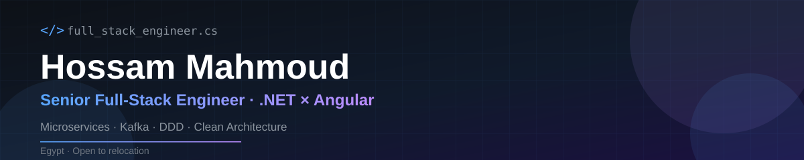
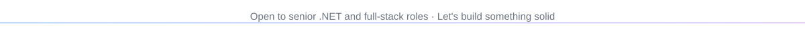

  

### Hi, I'm Hossam

Senior full-stack engineer working with .NET and Angular. I build microservice-based backends and the Angular front ends on top of them.

Right now I'm building features on a large platform of about 20 Kafka-connected microservices (.NET 10 and Angular 21) at Tahaluf Al Emarat Technical Solutions.

---

### What I work with

| Area | Stack |
|---|---|
| **Backend** | C#, .NET 8/10, ASP.NET Core, EF Core, Dapper, gRPC, SignalR |
| **Architecture** | DDD, CQRS with MediatR, Clean Architecture, microservices, modular monolith, outbox pattern |
| **Messaging & data** | Kafka, RabbitMQ, MassTransit, Redis, PostgreSQL, SQL Server, Oracle |
| **Frontend** | Angular, TypeScript |
| **DevOps** | Docker, Azure DevOps, Jenkins |

---

### Featured projects

| Project | What it shows | Built with |
|---|---|---|
| [**TDD-APP**](https://github.com/Hossam-Mahmoud50/TDD-APP) | ASP.NET Core Web API built test-first, with xUnit tests | .NET · xUnit |
| [**Rabbit-MQ-Demos**](https://github.com/Hossam-Mahmoud50/Rabbit-MQ-Demos) | RabbitMQ producer and consumer patterns in .NET | .NET · RabbitMQ |
| [**ITIFinialProject**](https://github.com/Hossam-Mahmoud50/ITIFinialProject) | ITI graduation project: ASP.NET Core 6 MVC application | .NET 6 · MVC · EF Core |

---

### Find me elsewhere

- **LinkedIn:** [linkedin.com/in/hossammmahmoud](https://www.linkedin.com/in/hossammmahmoud/)
- **X:** [@mr_hossam50](https://x.com/mr_hossam50)

  

